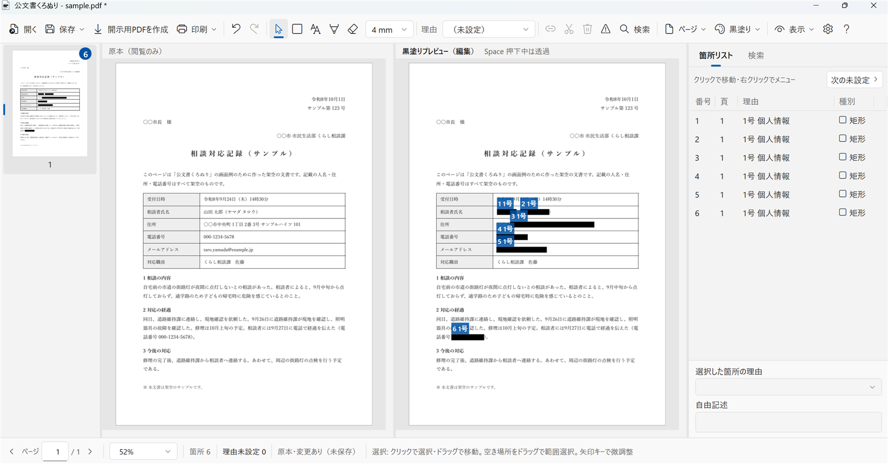

# 公文書くろぬり（koubunsho-kuronuri）

[](https://github.com/efukan/koubunsho-kuronuri/actions/workflows/ci.yml)

**PDF の黒塗り（墨消し）専用の Windows デスクトップアプリです。** 情報公開請求への対応などで、PDF の一部を黒塗りして外部に交付できる「開示用PDF」を作ります。自治体の LGWAN 端末（インターネットに出られない・管理者権限がない・GPU のない低スペック機）でそのまま動くことを目標にしています。



> **現在の版は 0.9.2（プレビュー）です。** 開発機と合成データでの確認は済んでいますが、実際の文書・実際の端末・Adobe Acrobat での確認はまだです（[未確認の事項](#未確認の事項)）。業務で使う前に、必ずお手元の文書で結果を確かめてください。

## 特長

- **黒塗りの下の文字が残らない。** 開示用PDFは、全ページを画像にして黒塗りをピクセルに焼き込み、新しい PDF として書き出します。黒い四角を上に重ねるだけの方式ではないので、コピーや文字検索で下の文字が読めることはありません。
- **書き出した直後に自動で検証します。** 開示用PDFを読み直し、文字情報・注釈・添付ファイル・メタデータなどが残っていないこと、黒塗りの位置が正しく黒いことを確かめ、合格したときだけファイルを残します。
- **原本を書き換えません。** 原本は読み取り専用で開き、同じ場所への上書き保存は受け付けません。
- **端末に痕跡を残しにくい作り。** 一時ファイル・AppData・レジストリを使わず、ログも出しません。外部との通信は一切しません（更新確認もありません）。
- **作業の途中を「確認用PDF」として保存できます。** 原本と黒塗り箇所・理由を1つの PDF にまとめ、庁内での確認や、別の担当者への引き継ぎに使えます（外部への交付は厳禁）。
- **黒塗りの理由（号）を箇所ごとに管理できます。** 理由の候補は `settings.json` で各団体の条例に合わせて変えられます。
- **探して塗る。** 文字の上をなぞる文字ツール、語句や電話番号・メールアドレスの検索からまとめて黒塗りができます。
- **ページの回転・並べ替え・開示しないページの除外**ができます。
- 原本と黒塗りプレビューの2画面表示、ページを続けて読める連続スクロール（1ページずつの表示にも切り替え可）、ライト／ダークのテーマ、小さい画面への対応。

## 動作環境

- Windows 10 / 11（64 ビット）
- .NET Framework 4.8（Windows 10 1903 以降・Windows 11 に標準で入っています）
- インストール不要・管理者権限不要。ZIP を展開したフォルダから起動します。

## 導入

1. [Releases](https://github.com/efukan/koubunsho-kuronuri/releases) から `kuronuri-<版>.zip` をダウンロードします。
2. リリースに記載の SHA-256 と一致することを確認します（PowerShell: `Get-FileHash .\kuronuri-0.9.2.zip`）。
3. 任意のフォルダに展開し、`Kuronuri.exe` を起動します。

- 実行ファイルにはコード署名をしていません。初回起動時に Windows の SmartScreen が警告を出すことがあります。ZIP のプロパティで「許可する」にチェックしてから展開すると出にくくなります。
- LGWAN 端末への持ち込みは、各団体の情報セキュリティのルールに従ってください。
- 理由の候補・既定のスタイルなどは、同じフォルダの `settings.json` で変更できます。
- **削除（アンインストール）**: 展開したフォルダごと削除してください。本アプリはレジストリ・AppData・スタートメニューなどに何も書き込まないので、ほかに消すものはありません（設定はフォルダ内の `settings.json` だけです）。

## 使い方

1. 原本の PDF を開く（ドラッグ＆ドロップでも開けます）。
2. 黒塗りする箇所を、矩形・文字・手書きのツールや検索で指定し、理由（号）を設定する。
3. 途中で「確認用PDFに保存」すれば、後で続きから作業できます。
4. 「開示用PDFを作成」で、交付用の PDF を書き出します（自動で検証されます）。
5. 開示用PDFを開いて、全ページを目視で確認する。

詳しくは [利用の手引き](docs/USER_GUIDE.md)（アプリの F1 でも開けます）をご覧ください。

## 注意

- **最後は必ず人の目で確認してください。** 検索は PDF の文字情報だけを対象にします。スキャン画像や図の中の文字は検索できません。
- 黒塗りの形や長さから、元の文字数などが推測される場合があります。必要に応じて広めに塗ってください。
- 確認用PDFには原本がそのまま入っています。外部へ交付しないでください。
- ページファイル・休止状態ファイル・クラッシュダンプなど、Windows が管理するデータはアプリからは消せません（[利用の手引き §6](docs/USER_GUIDE.md)）。
- パスワードが必要な PDF には対応していません。

## 未確認の事項

次の項目は、開発機（Windows 11・175% 表示）と合成データでは確認済みですが、実物・実機では未確認です。詳細と結果は [設計書 §17](docs/ARCHITECTURE.md) にまとめています。

- 確認用PDF・開示用PDFを Adobe Acrobat Reader や Edge で開いたときの見え方
- 実際の文書（スキャン文書・大量ページ）での開示用PDFのファイルサイズと処理時間
- 実際のプリンタでの印刷（Microsoft Print to PDF では確認済み）
- 低スペック機、1366×768 や 125%/150% 表示の端末での操作感

確認していただけた方は、結果を Issue で教えていただけると助かります（文書の内容は書かないでください）。

## 開発

```
dotnet build Kuronuri.sln -c Release
dotnet test Kuronuri.sln -c Release
pwsh tools/check-forbidden.ps1      # 一時ファイル・レジストリ・通信・ログ・依存追加がないかの検査
pwsh tools/make-release.ps1         # 検査・ビルド・テストの後に dist/kuronuri-<版>.zip を作る
pwsh tools/make-icon.ps1            # アプリのアイコンを作り直す
```

- C# / WPF / .NET Framework 4.8（x64）。ビルドには .NET SDK 8 以降が必要です。
- 第三者のライブラリは PDFium（[bblanchon/pdfium-binaries](https://github.com/bblanchon/pdfium-binaries)、`bblanchon.PDFium.Win32` 159.0.8152）だけです。開示用PDFは自前の最小 PDF ライターで書き出します。
- 設計は [docs/ARCHITECTURE.md](docs/ARCHITECTURE.md)、作業の記録は [docs/TASKS.md](docs/TASKS.md) にあります。`CLAUDE.md` は AI コーディングアシスタント向けの作業指示です。

```
src/Kuronuri.Core/          PDFium 層・モデル・Undo・開示用PDFの出力と検証・確認用PDF・印刷（UI 非依存）
src/Kuronuri.App/           WPF アプリ本体
tests/Kuronuri.Core.Tests/  xUnit テスト（テスト用 PDF はコードで生成します）
docs/                       設計書・利用の手引き
tools/                      検査・配布用 ZIP・アイコンのスクリプト
```

## プライバシー

本アプリは、ほかのネットワーク上のシステムに一切の情報を送信しません（更新確認・利用状況の送信・テレメトリもありません）。文書の内容・ファイル名・パスを、ログや設定ファイルに書き込むこともありません。

*This program will not transfer any information to other networked systems.*

## コード署名の方針

- 配布 ZIP は、公開しているこのリポジトリのソースから GitHub Actions（[release.yml](.github/workflows/release.yml)）でビルドします。
- 現在のリリースはコード署名をしていません。オープンソース向けの無償署名（SignPath Foundation）を申請する予定です。承認された後は、本アプリの実行ファイル（`Kuronuri.exe`・`Kuronuri.Core.dll`）だけに署名し、ここに署名の提供元を記載します。同梱の `pdfium.dll` は第三者がビルドしたもので、署名の対象にしません。
- 役割（いずれも [@efukan](https://github.com/efukan)）:
  - 開発・コミット（Committers）・レビュー（Reviewers）: efukan
  - 署名の承認（Approvers）: efukan
- 各リリースの SHA-256 はリリースのページに記載します。

## 不具合・脆弱性の報告

- 不具合や要望は [Issues](https://github.com/efukan/koubunsho-kuronuri/issues) へ。**実際の文書や、その内容が分かる画面は添付しないでください。**
- 黒塗りの下の情報が読めてしまうなど、安全に関わる問題は公開の Issue ではなく、[SECURITY.md](SECURITY.md) の方法で非公開で報告してください。

## ライセンス

[MIT License](LICENSE)。同梱する `pdfium.dll` とそれに含まれるライブラリのライセンスは [THIRD-PARTY-NOTICES.txt](THIRD-PARTY-NOTICES.txt) にあります。

本ソフトウェアは無保証です。黒塗りの結果は、利用者の責任で確認してください。
